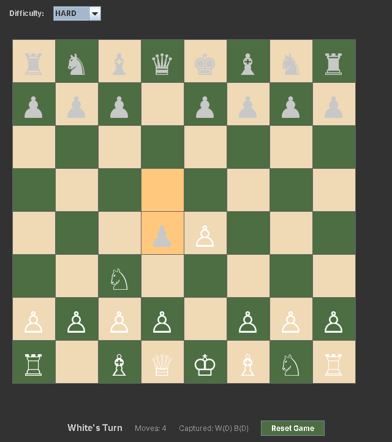

<div align="center">

# ♟️ Chess Game with AI Opponent

A desktop chess game in pure Java Swing where you play White against a computer opponent that searches with **Minimax and Alpha-Beta Pruning**.




</div>

---

## Features

**Chess rules**
- Legal move generation for all six piece types
- Castling, en passant and pawn promotion (pawns promote to a queen)
- Check, checkmate and stalemate detection

**AI opponent**
- Minimax search with Alpha-Beta Pruning
- Move ordering (captures searched first) for better pruning
- Four difficulty levels, changeable at any time from the dropdown
- Plays a checkmate immediately when one is available
- 3-second search time limit per move, so the game never freezes

**Interface**
- Cream and forest-green board with anti-aliased Unicode pieces
- Highlights for the selected piece's legal moves and for the last move
- Live status bar: whose turn, check / checkmate / stalemate, move count and captured pieces
- Reset button to start a new game
- The AI thinks on a background thread, so the window stays responsive

## Difficulty levels

| Level | Search depth | Plays like |
|---|---|---|
| Easy | 2 plies | Sees immediate threats |
| Medium | 3 plies | Spots simple tactics |
| Hard (default) | 4 plies | Solid, careful play |
| Expert | 5 plies | Deepest search, slowest |

## How the AI evaluates a position

| Factor | Value |
|---|---|
| Pawn / Knight / Bishop / Rook / Queen | 100 / 320 / 330 / 500 / 900 |
| Centre control | Bonus that grows as a piece gets closer to the centre |
| Giving check | +50 |
| Checkmate | Winning score |

Moves are searched in order (captures first, ranked by the value of the captured piece) so Alpha-Beta can cut off weak branches early.

## Project structure

```
src/
├── pieces/   Piece (abstract) + Pawn, Knight, Bishop, Rook, Queen, King
├── board/    Board: 8x8 grid, move execution, en passant checks
├── game/     ChessGame: turns, rule enforcement, game state
├── ai/       AIPlayer: Minimax + Alpha-Beta, evaluation, move ordering
└── ui/       ChessFrame (window, controls, game loop) and GamePanel (board drawing, mouse input)
```

Each piece class computes its own legal moves (polymorphism over the abstract `Piece`), so the board and game logic never need to know piece-specific rules.

## Getting started

**Requirements:** JDK 8 or newer. No external libraries.

```bash
git clone https://github.com/ZainAftab-dev/Chess-Game.git
cd Chess-Game

# compile
javac -d bin $(find src -name "*.java")

# run
java -cp bin ui.ChessFrame
```

On Windows (PowerShell):

```powershell
javac -d bin (Get-ChildItem -Recurse src\*.java).FullName
java -cp bin ui.ChessFrame
```

Or open the folder in IntelliJ IDEA / Eclipse / VS Code and run `ui.ChessFrame`.

## How to play

1. You are White. Click one of your pieces to see its legal moves.
2. Click a highlighted square to move.
3. Black (the AI) replies automatically.
4. Change the difficulty from the dropdown at any time, or press **Reset Game** to start over.

## Known limitations

- No threefold-repetition or 50-move draw rules
- Promotion always gives a queen
- No move history export (PGN) or save/load

## Author

**Zain Aftab** · [GitHub](https://github.com/ZainAftab-dev) · [LinkedIn](https://www.linkedin.com/in/zain-aftab-563727295/)

## License

[MIT](LICENSE)
